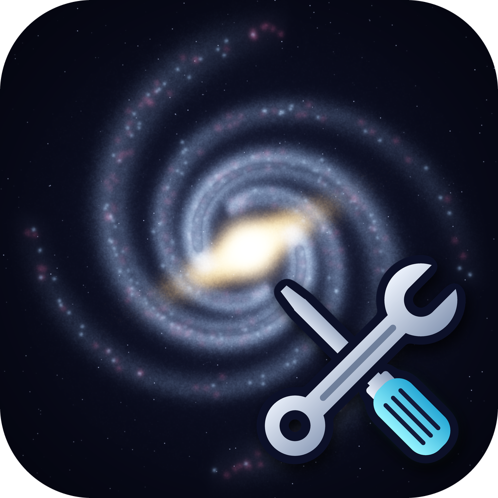
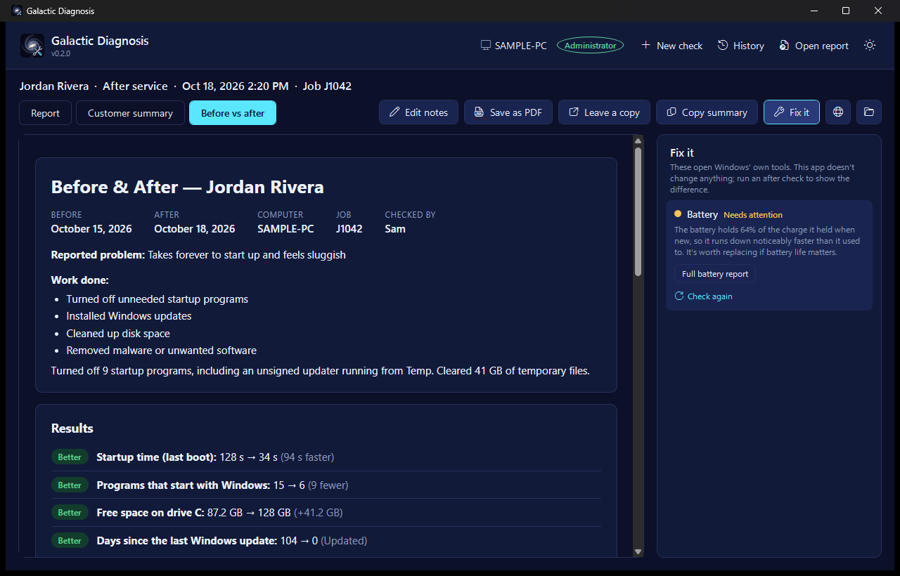
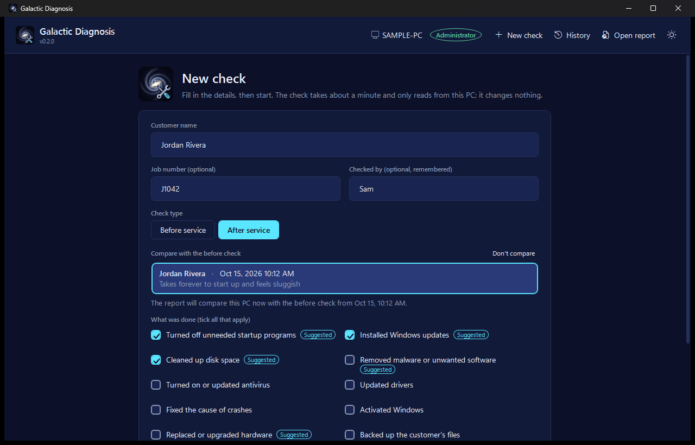
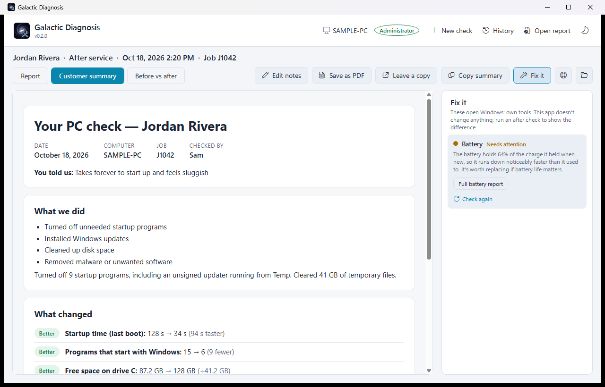
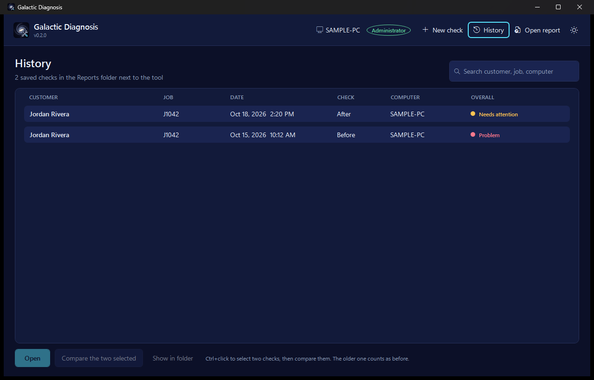

<p align="center"></p>

# Galactic Diagnosis

A Windows PC health check for repair technicians. Run it from a USB stick on a customer's PC. It writes a plain-English report the customer can read, and after the repair a before/after page showing what changed.



- **One file, nothing to install.** A self-contained `.exe` that runs on any Windows 10 or 11 PC, straight from a USB stick.
- **Written for the customer.** Every section gets a verdict (Good, Needs attention, Problem) and a sentence a non-technical person can follow.
- **Read-only and offline.** It reads built-in Windows sources (WMI, the event log, the registry), changes nothing, and sends nothing anywhere.

Sample pages built from made-up data for a generic laptop: [health report](docs/sample/sample-report.html) · [before/after comparison](docs/sample/sample-comparison.html) · [customer summary](docs/sample/sample-summary.html) (download them and open in a browser).

## The app

| | |
| --- | --- |
|  |  |
| **New check:** customer, job number, before or after. An after check picks its before check and offers a checklist of common jobs, with suggestions from what the before check found. | **Report viewer:** the full report, a one-page customer summary and the before/after comparison, in dark or light. |
|  |  |
| **History:** every saved check, searchable. Open one or compare any two. | **The pages themselves** are plain HTML files that print cleanly; the [health report](docs/images/sample-report.png) looks the same. |

- **Live progress.** Each of the 10 checks reports as it finishes. Cancel any time; nothing is saved.
- **Fix it.** For each finding, a button opens the Windows tool that fixes it (Startup apps, Storage, Windows Update, Windows Security, Device Manager, Reliability Monitor and more). **Check again** re-runs just that check to confirm the fix.
- **Hand it over.** Save any page as a PDF, leave PDFs on the customer's Desktop, or copy a plain-text summary for an invoice, ticket or message.
- **Edit notes** after a run, and the saved report files are updated.
- **History.** Search every saved check, open one, or compare any two.

## What it checks

| Section | What it looks at | Flags |
| --- | --- | --- |
| Hardware | CPU, graphics (with real VRAM), memory sticks, motherboard, BIOS | Missing graphics driver, under 8 GB of memory |
| Drive health | Windows' drive health status plus wear, temperature, power-on hours and uncorrected errors | Failing or worn-out drives, overheating, old hard drives, Windows on a spinning hard drive |
| Battery | Design capacity vs. full charge from `powercfg /batteryreport` (hidden on desktops) | Under 70% of original capacity |
| Crashes | Blue screens (with plain-English stop codes), unexpected shutdowns, program crashes and minidumps over the last 30 days | Repeated blue screens, freezes, a program that keeps crashing |
| Startup time | Windows' own boot timing (last boot and typical) | Over 60 seconds |
| Startup programs | Run keys and Startup folders, respecting what's switched off in Task Manager, with signature checks | 12+ programs, unsigned entries, anything running from Temp |
| Disk space | Free space on every fixed drive | Windows drive under 20% / 25 GB free |
| Windows updates | Date of the last installed update, pending restarts | Over 45 days without updates |
| Antivirus | Security Center status | None running, out-of-date definitions, two at once |
| Activation | Windows license status, edition and channel | Not activated |

## Using it

1. Copy `GalacticDiagnosis.exe` to a USB stick.
2. On the customer's PC, double-click it and accept the administrator prompt. Drive health details, startup time and crash dumps need admin.
3. **New check → Before service.** Enter the customer's name and the problem they reported, then **Start check**.
4. After the repair, **New check → After service.** Tick what you did, then **Start check**. The report opens on the before/after comparison.

Reports are saved to a `Reports` folder next to the exe, so they stay on the stick:

```
Reports\Rivera_J1042_2026-10-15_before.html   ← health report
Reports\Rivera_J1042_2026-10-15_before.json   ← raw data
Reports\Rivera_J1042_2026-10-18_after.html
Reports\Rivera_J1042_2026-10-18_after.json
Reports\Rivera_J1042_2026-10-18_comparison.html
```

Keyboard: **Ctrl+N** new check, **Ctrl+Enter** start, **Ctrl+H** history, **Ctrl+O** open a saved report. Your theme, window size and technician name are remembered in `GalacticDiagnosis.settings.json` next to the exe.

### The console version

`GalacticDiagnosis-Console.exe` runs the same checks and writes the same files, with prompts instead of a window. Use it on a PC where the window won't start, or for scripting:

```
GalacticDiagnosis-Console.exe --name "Jordan Rivera" --complaint "Slow" --job J1042 --tech Sam --no-prompt
GalacticDiagnosis-Console.exe --name "Jordan Rivera" --after --work "Removed startup programs" --no-prompt
GalacticDiagnosis-Console.exe --compare Rivera_2026-10-15_before.json Rivera_2026-10-18_after.json
GalacticDiagnosis-Console.exe --render Rivera_2026-10-18_after.json
GalacticDiagnosis-Console.exe --summary Rivera_2026-10-18_after.json
```

### Network use

Galactic Diagnosis never sends anything over the network. The window shows reports with Microsoft's WebView2 (Edge) runtime, with all web access switched off; the runtime itself may still make its own connection to Microsoft, as Edge does, but no report data can reach it. The console version opens no connections at all. If a PC doesn't have WebView2 (only old, un-updated Windows 10), reports open in the browser instead.

### SmartScreen

The exes aren't code-signed, so Windows SmartScreen will warn the first time they run. Choose **More info → Run anyway**.

## Build

Requires the .NET 8 SDK.

```
dotnet publish src\GalacticDiagnosis.Gui -c Release -o publish
dotnet publish src\GalacticDiagnosis.Console -c Release -o publish
dotnet test
```

This produces `publish\GalacticDiagnosis.exe` (about 65 MB) and `publish\GalacticDiagnosis-Console.exe` (about 34 MB), both self-contained single files. The repo's `nuget.config` pins nuget.org as the package source. The icon is generated by `assets/make_icon.py` (Python with Pillow and NumPy); the generated files are committed.

Layout: `GalacticDiagnosis.Core` (one collector per section, comparison, checklist), `GalacticDiagnosis.Report` (self-contained HTML reports, saving and pairing runs), `GalacticDiagnosis.Gui` (WPF + WebView2 window), `GalacticDiagnosis.Console` (console front end), `tests/`. Progress and design notes are in [STATUS.md](STATUS.md), [docs/BUILD_PLAN.md](docs/BUILD_PLAN.md) and [docs/GUI_PLAN.md](docs/GUI_PLAN.md).

## License

[MIT](LICENSE)
