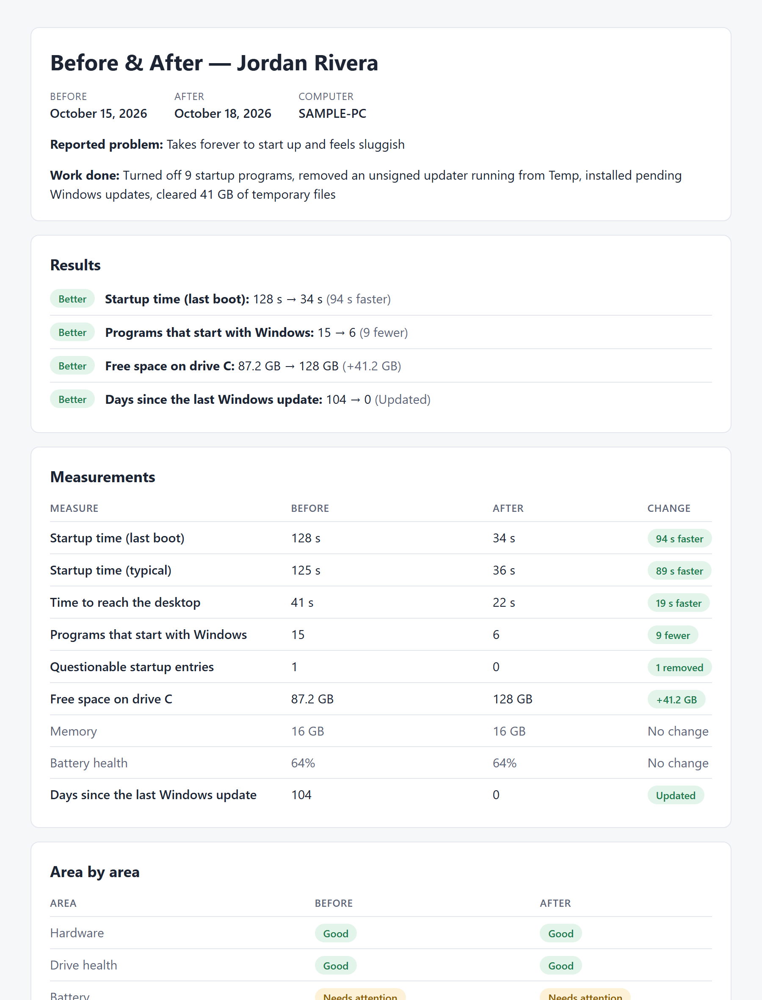

# Galactic Diagnosis

A Windows PC health check for repair technicians. Run it from a USB stick on a customer's PC. It writes a plain-English report the customer can read, and after the repair a before/after page showing what changed.



- **One file, nothing to install.** A single self-contained `.exe` that runs on any Windows 10 or 11 PC.
- **Written for the customer.** Every section gets a verdict (Good, Needs attention, Problem) and a sentence a non-technical person can follow.
- **Nothing leaves the machine.** It reads only built-in Windows sources (WMI, the event log, the registry) and makes no network calls.

Sample pages: [health report](docs/sample/sample-report.html) · [before/after comparison](docs/sample/sample-comparison.html) (download them and open in a browser). They're built from made-up data for a generic laptop; try `--compare docs\sample\sample-before.json docs\sample\sample-after.json` to regenerate the comparison.

## What it checks

| Section | What it looks at | Flags |
| --- | --- | --- |
| Hardware | CPU, graphics (with real VRAM), memory sticks, motherboard, BIOS | Missing graphics driver, under 8 GB of memory |
| Drive health | Windows' drive health status plus wear, temperature, power-on hours and uncorrected errors | Failing or worn-out drives, overheating, old hard drives, Windows on a spinning hard drive |
| Battery | Design capacity vs. full charge from `powercfg /batteryreport` (hidden on desktops) | Under 70% of original capacity |
| Crashes | Blue screens (with plain-English stop codes), unexpected shutdowns, program crashes and minidumps over the last 30 days | Repeated blue screens, freezes, a program that keeps crashing |
| Startup time | Windows' own boot timing (last boot and typical) | Over 60 seconds |
| Startup programs | Run keys and Startup folders, respecting what's switched off in Task Manager, with signature checks | 12+ programs, unsigned entries, anything running from Temp |
| Disk space | Free space on every fixed drive | Windows drive under 20% / 25 GB free |
| Windows updates | Date of the last installed update, pending restarts | Over 45 days without updates |
| Antivirus | Security Center status | None running, out-of-date definitions, two at once |
| Activation | Windows license status, edition and channel | Not activated |

## Using it

1. Copy `GalacticDiagnosis.exe` to a USB stick.
2. On the customer's PC, right-click it and choose **Run as administrator**. Drive health details, startup time and crash dumps need admin. Without it, those sections say so instead of failing.
3. Enter the customer's name, choose **before**, and type the problem they reported.
4. After the repair, run it again and choose **after**, then type what you did.

Reports are saved to a `Reports` folder next to the exe:

```
Reports\Rivera_2026-10-15_before.html   ← health report (print to PDF from any browser)
Reports\Rivera_2026-10-15_before.json   ← raw data
Reports\Rivera_2026-10-18_after.html
Reports\Rivera_2026-10-18_after.json
Reports\Rivera_2026-10-18_comparison.html   ← made automatically by the after run
```

The after run finds the latest before run from the same PC, preferring the same customer. To compare any two runs by hand, or to rebuild a report from its data:

```
GalacticDiagnosis.exe --compare Rivera_2026-10-15_before.json Rivera_2026-10-18_after.json
GalacticDiagnosis.exe --render Rivera_2026-10-18_after.json
```

For scripted runs: `--name "Jordan Rivera" --complaint "..." --after --work "..." --no-prompt`.

### SmartScreen

The exe isn't code-signed, so Windows SmartScreen will warn the first time it runs. Choose **More info → Run anyway**.

## Build

Requires the .NET 8 SDK.

```
dotnet publish src\GalacticDiagnosis.App -c Release -o publish
dotnet test
```

This produces `publish\GalacticDiagnosis.exe` (about 34 MB, self-contained single file). The repo's `nuget.config` pins nuget.org as the package source.

Layout: `GalacticDiagnosis.Core` (one collector per section, comparison logic), `GalacticDiagnosis.Report` (self-contained HTML, no scripts or external files), `GalacticDiagnosis.App` (console front end), `tests/`. Progress and design notes are in [STATUS.md](STATUS.md) and [docs/BUILD_PLAN.md](docs/BUILD_PLAN.md).

## License

[MIT](LICENSE)
